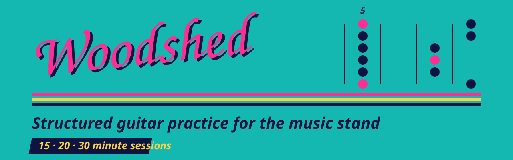
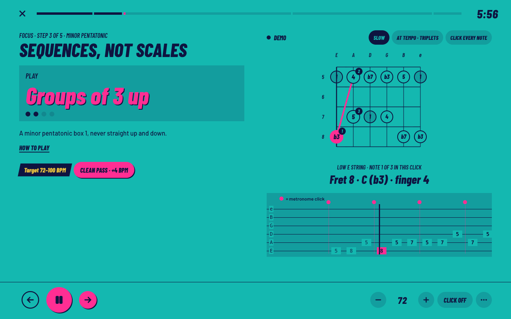
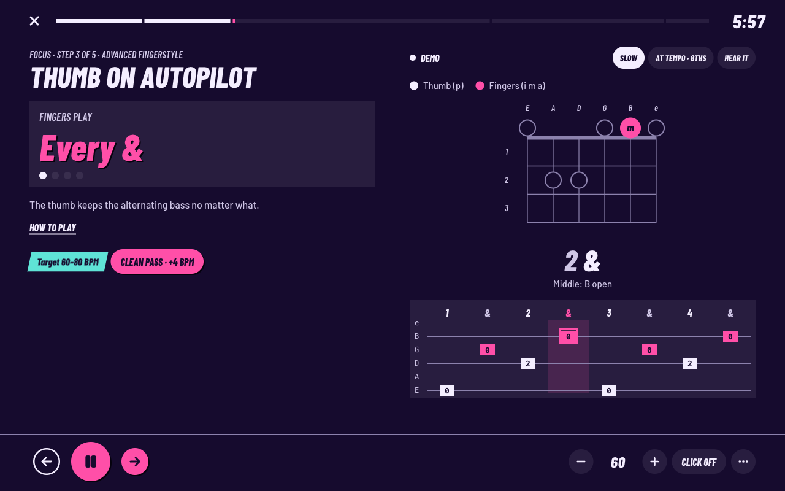
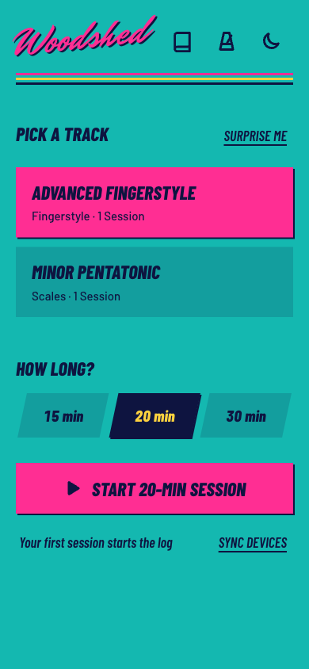
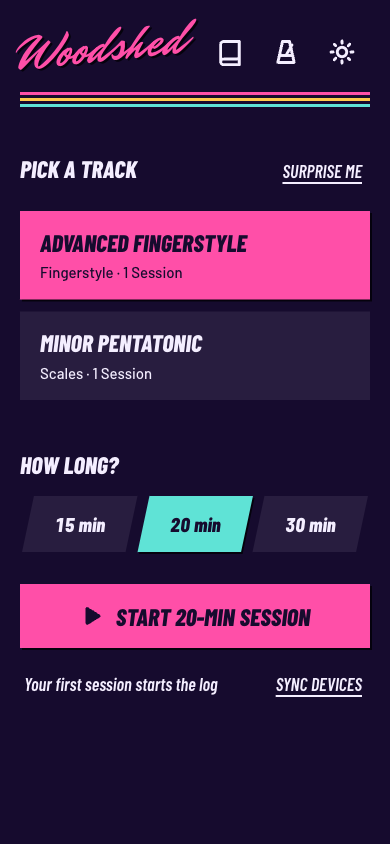

<picture>
  <source media="(prefers-color-scheme: dark)" srcset="assets/banner-dark.svg">
  
</picture>

<p>
  
  &nbsp;<b>A personal guitar practice app.</b> Pick a track and a length, and Woodshed runs the session for you: warm-up, review, focus, apply, cool-down.
</p>

Each step has a get-ready phase, a countdown, a target tempo, a built-in metronome and a visual guide: a fretboard with a scrolling tab, or a fingerstyle rhythm grid. It's built to be read from a phone or tablet on a music stand, one to two metres away. Type and tap targets are big, the screen stays awake, and there are keyboard shortcuts.

<table>
  <tr>
    <td width="50%"></td>
    <td width="50%"></td>
  </tr>
  <tr>
    <td align="center"><b>Ocean Drive</b> · light</td>
    <td align="center"><b>Night Drive</b> · dark</td>
  </tr>
</table>

<p align="center">
  
  &nbsp;&nbsp;
  
</p>

### What's in it

| | |
|---|---|
| **Tracks** | Advanced Fingerstyle, Minor Pentatonic, the CAGED System, Triads and Style Studies (Mayer and Hendrix) so far. Jazz and funk are on the way. |
| **Sessions** | 15, 20 or 30 minutes in five steps. Every step has a twist, a goal or a musical context: live prompts that change every few bars, a drone to play over, a tempo ladder. |
| **Guides** | Fretboard with play order and a scrolling tab, or a fingerstyle rhythm grid. They play as a demo, or follow the metronome's click. |
| **Progress** | Rate each step Struggled, Okay or Clean, and the next session starts at the right tempo. A streak, and sync across devices with no account. |
| **Library** | Every scale in any key with the chords that go with it, the CAGED system on the whole neck, and triads in every inversion on every string set. |

## Running it

Needs Node 20.19+ (Vite 8).

```bash
npm install
npm run dev      # http://localhost:5173
npm test         # Vitest, all unit tests
npm run build    # production build into dist/
npm run preview  # serve the build locally
```

Useful URLs while developing:

| Route | Screen |
|---|---|
| `#` | Home: track, duration, start |
| `#library` | Scale and CAGED library |
| `#scale/minorPentatonic/A` | One scale across the whole neck |
| `#caged/C` | CAGED shapes for a key |
| `#session/fingerstyle/15` | Jump straight into a session |

### Keyboard

| Key | Does |
|---|---|
| Space | Pause or resume the session |
| ← / → | Previous or next step (← restarts the step if it is more than 3 s in) |

## How it is built

React 19 with Vite, and Tailwind v4 for styling. It is plain JavaScript with no TypeScript and no router library: hash routes in `src/routes.js`. It has two themes, Ocean Drive (light) and Night Drive (dark). Both share the `--wd-*` tokens in `src/styles/theme.css`.

```
src/
  audio/       metronome (Web Audio lookahead scheduler), drone, chimes, shared AudioContext
  music/       note spelling, tuning, scales, chords, CAGED, harmony: all generated, never hand-placed
  fretboard/   SVG layout math
  session/     pure session logic: the step clock, prompts, pattern and grid generators
  data/
    exercises/ the exercise library (reusable step bodies with variants)
    tracks/    tracks, whose sessions are recipes over exercises
    library.js createLibrary / expandSession
    schema.js  content validation
  components/  Fretboard, PatternGuide, GridGuide, metronome UI, session bars…
  hooks/       wake lock, session clock, follow-the-click
  screens/     Home, Library, ScaleDetail, CagedDetail, Session, SessionDone
tests/         mirrors src/
```

The music theory is computed, not typed in. Notes are spelled from degrees (`b3` in A is C, not B#), positions come from the tuning, and the tests check the theory. If a diagram is wrong, fix the generator, not the data.

## Adding content

Content lives in two layers.

1. **Exercises** (`src/data/exercises/`) are reusable step bodies: instructions, tempo, the visual, prompts. An exercise can have **variants**, which are parameter sets such as key, box or start fret. The exercise builds a step from them.
2. **Sessions** (`src/data/tracks/`) are **recipes**. A recipe says which exercise and variant fills each step, and how long each step runs at 15, 20 and 30 minutes.

The same exercise can appear in many sessions and tracks. Fingerstyle session 1 reuses `pentatonic-groups-of-3` as its review step, for example. Each built step also records its `exercise` id and `variant`, so history and a daily mix can track them later.

### Add an exercise

Add an object to a file in `src/data/exercises/`, or create a new file and list it in `src/data/exercises/index.js`:

```js
const bendToPitch = {
  id: 'pentatonic-bend-to-pitch',        // unique across the whole library
  title: 'Bend to pitch',                // the step title on screen
  roles: ['focus', 'apply'],             // which step kinds it may fill
  tags: ['minor-pentatonic', 'bends'],
  level: 2,                              // 1-5
  variants: [{ root: 'A', position: 1 }, { root: 'E', position: 1 }],  // optional
  build: ({ root, position }) => ({
    instruction: `Bend the 4 up to the 5 in ${root}, box ${position}. Play the target fretted first, then match it.`,
    success: 'The bend lands on the fretted pitch every time: no flat, no sharp.',
    bpm: { min: 60, max: 80 },           // or null for no tempo
    fretboard: { type: 'pentatonic', root, quality: 'minor', position },
    drone: { root },                     // optional
  }),
};
```

Without `variants`, `build` is called with `{}`. Write instruction text from the variant (`${root}`), or compute it the way `firstGroups` does in `pentatonic.js`. That way the words always match the key.

### Step fields

`build` returns these fields. `kind` and `seconds` come from the recipe.

| Field | Required | What it is |
|---|---|---|
| `instruction` | yes | Full how-to. The first sentence is shown on its own, so make it the gist. |
| `success` | yes | What good looks like. |
| `bpm` | yes | `{ min, max }` or `null`. The metronome starts at `min`. |
| `fretboard` | one of these two | A diagram spec: `{ type: 'pentatonic', root, quality, position }`, `{ type: 'scale', root, scale, position? }`, `{ type: 'caged', root, shape, quality }`, `{ type: 'caged-scale', root, shape, scale? }` or `{ type: 'triad', root, quality, set, inversion \| near }`. |
| `pattern` | one of these two | Animated guide. `{ notesPerBeat, spec }` or `{ notesPerBeat, byPrompt: { [promptItem]: spec } }`. A spec is a `spider` (`startFret`, `order`), a `sequence` (`of`: a fretboard spec, `group` or `skip`, `direction`), a written `phrase` (`key`, `root`, `notes: [[string, fret, technique?]]` with techniques `h p s b v`, optional `of` shape to show behind it) or a fingerstyle `grid` (`slotsPerBeat`, `beats`, `shape`, `events`). A spec may set its own `notesPerBeat` (1-4). |
| `prompt` | no | `{ label, items, everyBars, order: 'cycle' \| 'random', root? }`. A big cue that changes every few bars. With `root`, degree items also show the note name. |
| `drone` | no | `{ root }`. A low drone while the step runs. |
| `ladder` | no | `{ by }`. Adds a "Clean pass · +N BPM" button. |
| `title` | no | Overrides the exercise title. |

Every step must show something: a `fretboard`, a `pattern` or both.

### Add a session or track

A track file in `src/data/tracks/` exports metadata plus its sessions, each expanded from a recipe:

```js
import { expandSession } from '../library.js';
import { exercises } from '../exercises/index.js';

export default {
  id: 'minor-pentatonic', title: 'Minor Pentatonic', category: 'scales',
  summary: 'Make the most-used scale in rock sound like music, not a drill.',
  sessions: [
    expandSession({
      id: 'mp-2', title: 'Box 2: bends and targets', focus: 'One line on what this session trains.',
      steps: [
        { kind: 'warmup', exercise: 'spider', variant: 1 },
        { kind: 'review', exercise: 'pentatonic-sequences' },          // variant defaults to 0
        { kind: 'focus', exercise: 'pentatonic-bend-to-pitch', variant: 1 },
        { kind: 'apply', exercise: 'pentatonic-land-the-target', variant: 1 },
        { kind: 'cooldown', exercise: 'pentatonic-make-it-sing', variant: 1 },
      ],
      timing: {                    // seconds per step, in step order
        15: [120, 120, 360, 240, 60],
        20: [180, 120, 480, 360, 60],
        30: [240, 180, 720, 600, 60],
      },
    }, exercises),
  ],
};
```

New tracks are registered in `src/data/tracks/index.js`. Categories: `fingerstyle`, `caged`, `scales`, `fretboard`, `electric`, `rhythm`, `application`.

### Validation

Content is checked when the app loads and again in `npm test`, so a mistake fails fast with the exercise, track, session and step named. The checks:

- Exercise ids are unique. `roles` are step kinds, `level` is 1-5, and `build` is a function.
- A recipe step's `kind` must be one of its exercise's `roles`. `variant` must exist.
- Each `timing` entry has one length per step. Durations are only 15, 20 or 30, and the lengths must add up to exactly that many minutes.
- Every step has a `fretboard` or a `pattern`. Prompt, drone, ladder and pattern fields are checked too. `byPrompt` keys must be prompt items, grid notes need a string, a fret and a hand (`p i m a`), and so on.
- `tests/data/library.test.js` builds **every variant of every exercise** and validates it, so an unused variant can't rot.

The rules live in `src/data/schema.js` (steps and tracks) and `src/data/library.js` (exercises and recipes).

### Content rules

- No tablature or transcriptions of copyrighted songs. Write original exercises in the style you are after.
- Every step needs a twist, a goal or a musical context. Running a box up and down is not a step.
- Theory comes from the generators in `src/music/`. Add a test when you add a generator.

## Progress and sync

Each step you play for at least 15 seconds is logged with the exercise, the variant and the tempo you finished at. During the next step's get-ready, and on the done screen, you rate it: Struggled, Okay or Clean. Next time that exercise and variant come up, the session starts 4 BPM faster after Clean, 4 BPM slower after Struggled, and at the same tempo otherwise. The step's range sets the limits, and it never drops you below a tempo you've already passed. Home shows your streak.

History is saved in the browser first, then synced to Supabase when it's reachable, so practising offline is fine. There are no accounts. Each device gets a **sync code** (a random UUID), and putting the same code on another device under Home › Sync devices shares one history. Row-level security only lets a request read and write rows matching the code it sends.

To set it up:

1. Run `supabase/schema.sql` once in the Supabase SQL editor.
2. Copy `.env.example` to `.env.local` and fill in the project URL and the publishable (or legacy anon) key. That key is public by design.

Without those variables the app still works and keeps history on the device.

## Deploying

The build in `dist/` is static, so any static host works. The plan is GitHub Pages at `woodshed.bernaland.com`, with a CNAME record at the DNS provider pointing to `sbernal93.github.io`. The deploy workflow and PWA manifest are not set up yet.

## Contributing

`main` is protected: changes land through pull requests, merged with squash.
